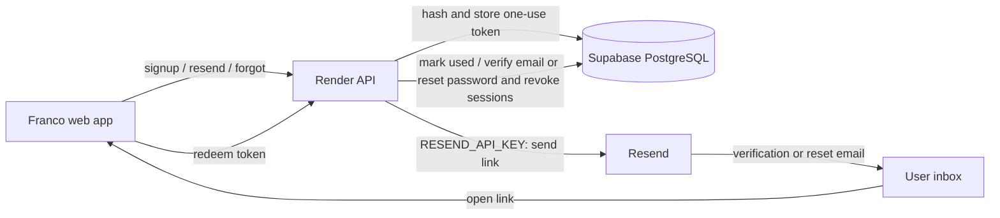

# Franco

Franco is a React MVP shell for a French learning platform. The current app is authentication-first and uses a Node API backed by Supabase PostgreSQL for users, sessions, learner profiles, progress rows, attempts, and mistakes.

## Backend data model

The Supabase PostgreSQL storage model is documented in [`supabase/schema.sql`](./supabase/schema.sql), with a relationship overview and guidance in [`supabase/README.md`](./supabase/README.md). Use those files when working with backend tables and columns; they describe the Supabase database, not the browser API response format.

### Import the normalized dataset

With `DATABASE_URL` set to the Supabase PostgreSQL connection string in `.env`, run `npm run import:normalized` to insert the rows from `normalized-content.json`. The importer follows the foreign-key order and skips rows that already exist, so it can be safely rerun.

## Run locally

This project requires Node.js 22.12.0. If you use nvm, load the pinned version with:

```bash
nvm install
nvm use
```

Then install dependencies and start the app:

```bash
npm install
npm run dev
```

The API requires `DATABASE_URL` (your Supabase PostgreSQL connection string) in `.env`. Email signup verification and password reset require `RESEND_API_KEY` on the **Render API service**. The PR Render preview is a separate service and also needs the key. When the key is absent, signup and email-request endpoints return `503 email_unavailable` rather than implying a message was sent. `EMAIL_FROM` defaults to `onboarding@resend.dev`, which can only send to the Resend account owner; use a verified-domain sender for other recipients. `FRONTEND_URL` defaults to `https://franco-dsh.pages.dev` and should be `http://localhost:5173` locally. Email requests made from Franco's own Pages preview link back to that preview. Keep `RESEND_API_KEY` server-side; the web app only receives email links. Existing users are backfilled as verified when the database migration runs; new email/password signups must verify before login. Google sign-in uses Google's verified email claim.

Friend Race (`/race`) uses the same `DATABASE_URL`; the API applies its race-table migration at startup. Set `VITE_SUPABASE_URL` and `VITE_SUPABASE_ANON_KEY` in the web app's local or Cloudflare Pages environment to enable Supabase Realtime room notifications. These are the public project URL and anon key, never the service-role key. Without them, the race still works through API polling. The host signs in, creates an invite, saves the rules in the lobby, and starts once a friend joins. Guests can join by name without an account. Signed-in race answers count toward attempts and streaks; guest answers stay within the race. Rooms expire after 24 hours and expired player data is removed by the API cleanup.




To run the email flow integration test against a **local** PostgreSQL database, set `TEST_DATABASE_URL` to its connection string and run `node scripts/test-auth-email.mjs`. The test uses a local fake Resend endpoint and never sends mail externally.

To load the founding content dataset, run:

```bash
npm run import:normalized
```

`data/` is git-ignored; it only holds the optional SQLite staging file used by the legacy corpus importers (`npm run import:ud-gsd`, `npm run import:tv5`).

Then start the API and web app with `npm run dev`. If the browser still shows loading, verify `http://127.0.0.1:8787/api/health` returns `{ "ok": true }` and open the Vite URL printed in the terminal.

The dev command starts both services:

- React/Vite: `http://127.0.0.1:5173/`
- API: `http://127.0.0.1:8787/`

The legacy corpus importers stage into a local SQLite file at `data/franco.sqlite`; the API itself only reads from Supabase.

## Content API contract

The scraper-facing contract is [`schemas/content.v1.schema.json`](schemas/content.v1.schema.json). It is immutable: breaking changes require a new version. The same schema can be downloaded from `GET /api/content/v1/schema` and validated by the scraper before submission.

Set `CONTENT_API_KEY` in the API environment. Send it as `X-API-Key` to submit batches. The API validates and normalizes each batch, enforces idempotency, records exact and near-duplicate candidates, and stages accepted items as `pending_review`. Review actions are available through the versioned content API; only `published` items are returned by the published-item endpoint.

Example batch shape:

```json
{
  "schema_version": "content.v1",
  "batch_id": "ud-2026-09-15-01",
  "idempotency_key": "ud-2026-09-15-01-retry-safe",
  "source": {
    "id": "example-source",
    "name": "Example Source",
    "url": "https://example.com",
    "license": "CC BY 4.0",
    "attribution": "Example Source"
  },
  "items": []
}
```

Run the contract checks with `npm run test:content-contract`.

To refresh the French content from UD French GSD:

```bash
npm run import:ud-gsd
```

To import the public TV5MONDE exercise catalogue into its separate table:

```bash
npm run import:tv5
```

## Current MVP behavior

- Login and sign-up screens call the local API.
- User accounts and password hashes are stored in Supabase PostgreSQL.
- Browser sessions use a bearer token stored in `sessionStorage`.
- The signed-in app shell includes Home, Placement, Session, Content, Past questions, Progress, and Conversation views.
- Sessions are adaptive: `GET /api/me/session-plan?section=A1` returns a queue ordered by due SM-2 reviews, then new items at the learner's level, then weak-concept items, then exam practice and legacy drills. The client renders the queue in server order — no client-side shuffling of the queue itself (MCQ options still use Fisher–Yates).
- Every answered exercise reports `{ item_kind, item_id|legacy_ref, response, duration_ms, hint_used }` to `POST /api/me/attempts`, which grades server-side, updates SM-2 state (`learner_item_state`) and concept mastery, and reveals the correct answer only after grading.
- One renderer per item type lives in `src/components/exercises/`: multiple choice (reading/grammar), tap-to-order word order, typed spelling/dictation, pronunciation drills with audio + self-marking, writing prompts with rubrics, and speaking prompts with follow-ups.
- The Content view has Roadmap, Writing, Speaking, and Vocabulary tabs for levels A1–C2. Speaking lessons provide task-specific model phrases, word comparison, and a separate open-answer prompt within the existing Speaking tab. Roadmap concepts, writing/speaking items, and vocabulary topics come from the canonical track (`/api/content/v1/concepts`, `/api/content/v1/items`, `/api/content/topics?section=...`).
- A 10-question placement quiz (`/placement`) sets the learner's CEFR level via `POST /api/me/placement`; the profile refreshes immediately after.
- The 90-topic roadmap is seeded from `content/curriculum/topics.json` via `npm run seed:concepts`. Authored `*.lessons.json` files enter separate lesson and question tables as generated drafts; use the scoped editorial queue to review and publish. Old concepts are retired, preserving historical attempts. Prerequisites recommend sequence and never lock access.
- Past questions show all skills (reading, listening, language structures) with section tabs A1–C2.
- No fake user progress or mistakes are rendered.

## Optional speaking transcription

The full FRA-10 implementation and setup guide is [docs/FRA-10-speaking-transcription-plan.md](docs/FRA-10-speaking-transcription-plan.md). Create a Groq project and API key in the [GroqCloud Console](https://console.groq.com/keys), enable Zero Data Retention in [Data Controls](https://console.groq.com/settings/data-controls), and confirm current limits on the [Limits page](https://console.groq.com/settings/limits).

Copy the speech variables from [.env.example](.env.example) into the API environment, set GROQ_API_KEY there, and set SPEECH_TRANSCRIPTION_ENABLED=true. Keep the key out of Vite variables and browser code. The API startup migration creates the usage ledger; the equivalent SQL is in [supabase/migrations/002_speech_transcriptions.sql](supabase/migrations/002_speech_transcriptions.sql) for manual deployment. Speech recording requires HTTPS or localhost. Listen & repeat accepts a typed answer when recording is unavailable; Read aloud requires a recording and gives tentative pronunciation hints.

Content feedback uses `GROQ_API_KEY` on the API server. It tries Qwen first,
then GPT-OSS 20B if Qwen fails or returns invalid feedback. Set
`GROQ_FEEDBACK_MODEL` and `GROQ_BACKUP_FEEDBACK_MODEL` to change the models.
Configure the `SPEECH_FEEDBACK_*` limits in [.env.example](.env.example) to cap
each learner's daily requests and tokens. The API logs the serving model but
never the learner's answer. Keep the key out of Cloudflare Pages and `VITE_`
variables.

`free_text` is an open response: typed answers count toward Writing, spoken answers are transcribed and count toward Speaking, and both use the same content-feedback rubric. New items can carry `response.example` for an optional collapsible example. `speaking_prompt` is now Read aloud: its `prompt` and `response.expected` must contain the same exact phrase. The FRA-126 startup migration archives historical attempts from legacy exact-answer Free Text items, deletes only those items, and reclassifies existing open speaking prompts as Free Text once.

Conversation recordings can run for two minutes through `POST /api/speech/conversation/transcribe`. They use the same speech usage ledger and limits, with a nullable content item reference. A recording is sent to Groq only when the learner requests feedback; the transcript and scenario targets are then sent through the content-feedback service. Typed answers skip transcription.

## Learner API (implemented)

- `GET /api/speech/status` — authenticated transcription availability
- `POST /api/speech/transcribe?item_id=...` — authenticated audio upload and practice feedback
- `GET /api/me` — user + profile
- `GET /api/me/session-plan?section=A1` — adaptive queue (reviews → new → weak concepts → exam → drills)
- `POST /api/me/attempts` — grade an answer, update SM-2 + mastery, reveal the answer
- `POST /api/me/placement` — set CEFR level from the placement quiz
- `GET /api/me/progress` — SM-2 state, concept mastery, recent attempts
- `GET /api/me/review-due` — items due for review
- `GET /api/me/conversation-targets`

## Planned data sources

The UD French GSD treebank can be used later as an open corpus source for annotated sentence examples, subject to its CC BY-SA 4.0 license and attribution requirements:

https://universaldependencies.org/treebanks/fr_gsd/

The current A1-B2 labels are local difficulty sections generated from sentence length and UD annotations. UD French GSD does not provide official CEFR labels, so these should be improved later with CEFRLex/FLELex or a reviewed curriculum.

Do not scrape France Éducation international's official TCF/DELF sample pages: their terms
prohibit reproducing exam samples, and copyright is retained by FEI. The previous
`import:tcf-official` scraper was removed for this reason. Exam-style practice items must be
original content authored for this project (see the `src_original_authored` source).

TV5MONDE reports more than 4,000 free exercises across A1-B2. The importer stores the paginated catalogue links and metadata in `tv5_exercises`; only links and catalogue metadata may be stored, never exercise content. The activity itself remains on TV5MONDE.
