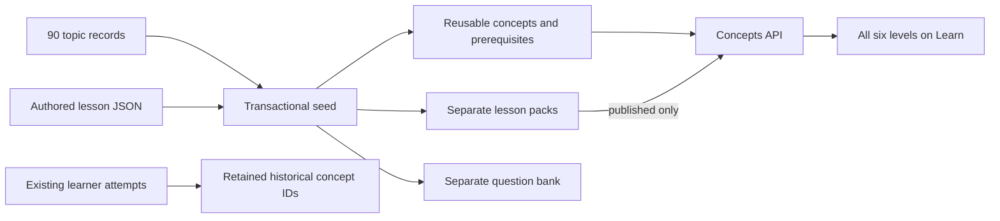

# 90-topic curriculum data

FRA-134 replaces the active roadmap with A1-01 through C2-15, preserving every
subtopic and suggested source mapping from the Learning curriculum document.
Run `npm run seed:concepts` after deployment. The seed is transactional and
repeatable: it retires old roadmap entries without deleting their IDs or attempts,
upserts the 90 concepts and their ordered prerequisite links, and imports new
`content/curriculum/*.lessons.json` files as generated drafts. It never resets
existing lesson approvals or publishes content. Changed packs need a deliberate
new version and renewed review; do not overwrite reviewed database content.

The rolling deployment keeps legacy output until the first reseed. Afterwards,
only curriculum IDs appear in the public roadmap. Drafts expose outline/subtopics
and status, without authored lesson bodies. Published packs populate the full
recommended lesson metadata. Prerequisite links and display order are separate.
The curriculum schema is a reusable definition under the existing content.v1
contract; exercise batches retain their existing root shape.

Merge FRA-135 to render the eight-step page and FRA-136 to review/publish packs.
Public deployment and database seeding are separate from opening these PRs.
