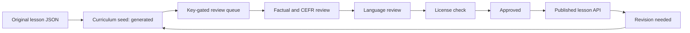

# Curriculum editorial review

FRA-136 depends on the curriculum storage/seed from FRA-134. Its branch starts
at main; merge FRA-134 first. Open the existing internal Review queue and supply
a content:review key. Curriculum packs appear separately from exercise items.

Each transition requires reviewer name, evidence, current state and version.
Approvals bind to the exact pack hash. Revision invalidates earlier approvals.
Publication validates all eight lesson sections and source-derived item rights.
Link-only destinations belong in references, never copied exercise content.
Tatoeba requires per-record license verification; Wiktionary requires CC-BY-SA.
Original content is explicitly labelled and is never represented as human-reviewed.

GET /api/content/v1/curriculum/review returns packs and provenance for reviewers.
POST /api/content/v1/curriculum/{topic_id}/review advances one state with body:
`{version, from, state, reviewer, note}`. Both require x-api-key with content:review.
The server records the key fingerprint, reviewer, note, pack hash and version.
Concurrent reviews lock the lesson row; a stale state/version returns 409.

The seed never publishes. After these PRs merge, seed once, review each pack,
and publish through this surface. No production data is modified by a PR.
