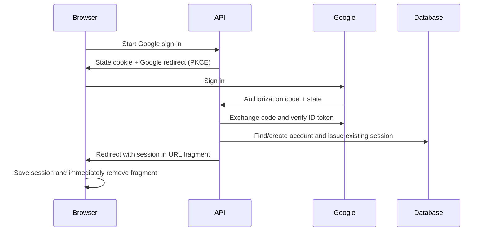

# Google sign-in (FRA-90 / FRA-43)

The Direction B button checks `/api/auth/google/status`, then navigates to
`/api/auth/google` on the configured API origin. The server uses the established
Google OAuth SDK for authorization-code exchange and ID-token verification.
State is single-use and expires in ten minutes, bound to a secure HTTP-only
SameSite=Lax cookie. PKCE and the ID-token nonce protect the redirect flow.
Verified Google emails link to the existing Franco account, or create a user
and profile; sign-in issues the same opaque session as password login.

Configure all four server variables from `.env.example`: `GOOGLE_CLIENT_ID`,
`GOOGLE_CLIENT_SECRET`, `GOOGLE_REDIRECT_URI`, and `GOOGLE_FRONTEND_URL`. Register
the exact local/deployed callback URI in Google Cloud. HTTPS is required outside
localhost. The Google button reports unavailability if configuration is missing.
No client secret is exposed to the browser.

Password reset remains a separate missing backend flow. The visible Forgot
password link opens an explanation rather than navigating to a dead endpoint.
