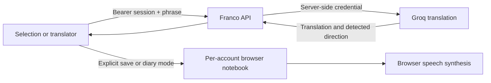

# Language tools (FRA-96)

Short phrases (up to 240 characters) translate through the authenticated
`POST /api/me/translate` endpoint. The existing server-side Groq credential is
reused; `TRANSLATION_MODEL` optionally overrides `openai/gpt-oss-20b`.
Requests have a timeout and bounded per-user/global capacity. Provider output
is validated before it reaches the client. No provider key reaches the browser.

The diary persists in this browser, scoped by Franco account ID. It is a pure
notebook: there are no attempts, mastery, review or scheduling writes. Entries
contain the phrase, meaning and language directions; pronunciation uses browser
speech synthesis. It does not sync between devices. Recent lookups last for
the current session. Selection modes start off and are mutually exclusive;
form controls and exercise answer buttons are excluded from selection handling.
