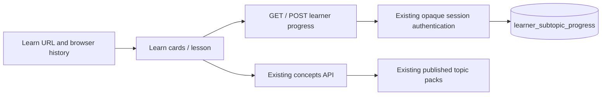

# Learn redesign: FRA-167–174

One branch and one PR to main cover the parent and all seven child tickets.
Dependencies were implemented within that branch: navigation and progress API,
then presenter/cards/dropdown, lesson progress, then legacy cleanup.

## Behavior and content

- URL: `/learn?level=A1&topic=A1-01&subtopic=A1-01-1`.
- Every level/topic/lesson action pushes history. Invalid parameters and legacy
  redirects replace only the current entry. `/content?concept=…` maps to
  `/learn?topic=…`, discarding the obsolete section parameter.
- Home Continue, Home Lesson, Home Explore, and Profile Explore now navigate
  to Learn. A search found no other `navigate('content', …)` callers.
- Header and foot both toggle the same card region. Only the header is a tab
  stop; collapsed rows unmount. Rows use real buttons and ≥44px tap targets.
- Lesson back uses browser history when the preceding entry is the expanded
  list. Cold links push a fallback expanded list. Jump back in establishes
  that list entry before opening the lesson.
- Subtopic titles and descriptions come from concepts. Each published topic's
  original pack is reused for all its subtopics; no lesson content is split,
  authored or generated. No durations or artificial progress are shown.
- Unpublished lessons remain openable, show In preparation and write nothing.
- Completion is a local lesson/mastery check, recorded per subtopic; it does not
  alter the existing learning-attempt/mastery endpoints. PostgreSQL's upsert
  preserves completed across racing or later in_progress writes.
- Progress failures never prevent reading or opening cards. Server and typed
  client reads include updated_at for the actual newest Jump back in target.

## Removed and retained code

Removed Content.tsx, the previous skill-tab Learn view, Roadmap.tsx, the orphaned
roadmap presenter/tests and unused roadmap CSS. Removed the old concepts map,
table, detail and vocabulary track renderers. `components/concepts.tsx` now only
holds level descriptions used by Placement. `learn.presenter.ts` retains the
practice inventory helpers used by usePracticeInventory and its existing tests.
New Learn card/route tests supplement those helpers.

## Database rollout

The new table is in schema.sql and an idempotent boot migration. It uses the
existing server-only custom-session model: RLS enabled with no public policy;
PUBLIC, anon and authenticated have no direct grants. Each API read/write scopes
the user from the existing Bearer session, never from request user IDs.

The Supabase CLI could not create its user configuration on the environment's
read-only home filesystem; the SQL file was prepared directly, then verified
through a fresh local PostgreSQL API boot. No production migration, content
seed, import or publication command was run.

## Verification

- Node 22.12.0: lint:ui, typecheck, npm test (including new card/route tests), build.
- Local PostgreSQL 17, `scripts/test-learn-progress-api.mjs`: fresh boot table,
  GET empty, POST/GET round-trip, timestamp, sticky completion including racing
  writes, validation 400s, missing authentication 401s, level and user isolation,
  and RLS. The test refuses non-local TEST_DATABASE_URLs. CI runs it too.
- Chromium uses API fixtures with actual curriculum titles/subtopics and a real
  authored pack. Before screenshots use main at 9d163e1; after screenshots use
  the implementation. Fixture publication is not a claim about live content.
- Back/Forward: A1 → A2 → topic → lesson; Back restores topic → A2 → A1;
  Forward replays all three. Refresh preserves the expanded card and row state.
- Cold lesson Back falls back to its expanded topic; legacy concept/section
  links normalize; invalid level/topic/subtopic parameters are removed.
- All pack sections render; wrong recognition answers allow retry; mastery
  writes completed once; return and refresh show Done; reopening does not
  downgrade or re-save the completed row.
- Phone/dark: single column, wrapping pills, visible rows, no horizontal scroll,
  persistent shell/tools. Progress failure, empty level and concepts error paths
  checked separately. Home Continue and Profile Explore route to Learn;
  Practice/Puzzles/Stories survive direct load and refresh.

Review checklist: ticket criteria, session boundary, atomic progress writes,
FRA-21/FRA-16, shared types, route history, content reuse and render evidence
checked. No known implementation blocker remained at review.
