# Focused Learn subtopics

Each of the 364 subtopics in `content/curriculum/topics.json` now has its own lesson. The 90 topic packs contain `subtopic_lessons`, keyed by the stable subtopic ID. `Learn` selects that entry; it never falls back to rendering the same topic overview for every subtopic. A missing entry shows the existing “In preparation” treatment and does not write progress.

`content/curriculum/subtopics.source.txt` contains the original teaching note, French example and English meaning for each subtopic, in the order declared by `topics.json`. `node scripts/build-subtopic-lessons.mjs` compiles these into version 3 packs. `--check` verifies that committed packs match the source without writing anything. The lessons provide three independent recognition checks, two written tasks and a word-bank mastery task; each question is graded independently. These are focused written introductions, not a substitute for audio, oral production or extended C1/C2 assessment.

```mermaid
flowchart LR
  A[Authored subtopic source] --> B[Offline pack builder]
  B --> C[Version 3 lesson JSON]
  C --> D[Existing seed pipeline]
  D --> E[Generated editorial queue]
  E --> F[Factual, language and licensing review]
  F --> G[Published topic and nested lessons]
  G --> H[Concepts API published projection]
  H --> I[Learn selects subtopic ID]
```

## Content rollout

No live seed or publication was performed for this change. This is deliberately separate from a code deployment: existing database packs do not update just because repository JSON changes.

1. For existing reviewed/published version 2 packs, use the existing editorial controls to mark “Needs revision”, then advance to `generated`. Those actions record reviewer evidence. The seed continues to protect reviewed content from silent replacement.
2. Run `npm run seed:concepts` with the normal configured database connection to import the version 3 generated packs. Packs already in `generated` can be updated directly. The seed validates nested content and complete subtopic coverage before inserting anything and runs in a transaction.
3. Review the complete pack, including its `subtopic_lessons`, for factual accuracy, CEFR fit, French, English, assessment quality and attribution, then publish through the existing editorial flow. A parent publication covers its nested lessons; generated content is not exposed by the public API. Previously published packs without subtopic material show “In preparation” after this code change until migrated.

The pretest checks all 90 topics and 364 subtopic IDs, unique explanations/examples, editorial validity, distinct question IDs, choice keys, and published-only projection. Presenter tests check casing, punctuation, whitespace and accent variants as well as misspellings and reordered answers for all 1,092 free-text and word-bank keys. Choice IDs remain exact matches.

`src/feature-flags.ts` keeps `realLifeCoach` false. [FRA-179](https://linear.app/twotales/issue/FRA-179/spike-contextual-ai-feedback-for-learn-use-it-in-real-life) tracks contextual model evaluation before that section returns.

## Rendered verification

The real `Learn` view was rendered with the version 3 pack data supplied by a mocked API; no database publication was used. Browser checks cover answering question 3 before question 1, wrong/retry/correct states, relaxed typed answers, translation toggling, mouse and touch swipes, vertical scrolling without moving tiles, no correct-answer feedback panel, all six A1-01 subtopic links, representative A2–C2 deep links, and mobile overflow. Screenshots are under `docs/screenshots/learn-fixes/`; existing before images remain under `docs/screenshots/learn-redesign/`.
