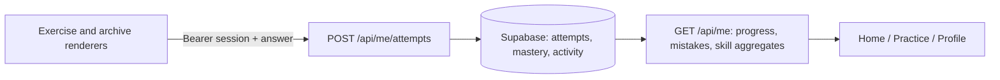

# Learner progress

`GET /api/me` is the shared learner snapshot for Home, Practice and Profile.
Learn's roadmap states use the same underlying concept mastery as
`GET /api/me/progress`. All learner queries bind the session's user ID.

Completion counts unique answered items, regardless of correctness. Retries
are stored as separate attempts but count once. `exercises_correct` counts
items ever answered correctly. Totals include published content with a
current revision and the exam archive, using `shared/learning-skills.js`.
Old UD drill rows duplicated in the published content bank are excluded.
Empty inventories return zero counts and zero percent for all 24 skill/level
combinations; they never show fictional progress.

Concept state is `completed` at mastery >= 0.8, `in_progress` when there is
evidence of practice, and `not_started` otherwise. Recent mistakes are the
last 50 incorrect attempts, newest first. Attempt history is limited to 100;
completion aggregates query the full history, so old completions persist.

The database already stores legacy exam attempts through `item_kind` and
`legacy_ref`; the checked-in schema now reflects these boot-time additions.
The private-data migrations enable RLS on all 32 API-owned public tables,
including content tables that previously bypassed the publication/review
boundary through anonymous Data API reads.
No client policies are added: custom Franco session tokens are validated by
the Node API, whose database role must own these tables or bypass RLS.
The configured connection uses `postgres`, verified to bypass RLS.

Supabase's [RLS-without-policy notice](https://supabase.com/docs/guides/database/database-linter?lint=0008_rls_enabled_no_policy)
is intentional here: no direct Data API clients are supported. The audit
after applying both migrations reports no security errors or warnings,
only these default-deny informational notices. Public published-content
reads remain available through the Node API.
