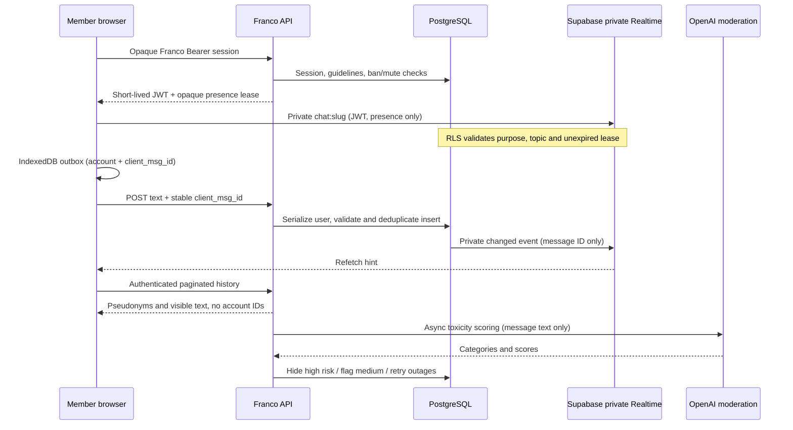

# Member chat (FRA-152)

`/chat` has five fixed rooms, pseudonyms, versioned guideline acceptance, unread
markers, reporting and own-message deletion. `/chat-moderation` is an internal
queue requiring a separate chat moderator key. There are no edits, uploads or
DMs. Messages and queued drafts expire after 28 days; moderation audit metadata
has no message body and survives message cleanup.

## Data and authorization

Franco sessions remain authoritative. The API signs a project-compatible HS256
JWT lasting at most 60 seconds, bounded by the session expiry. The JWT subject
is a separate random chat member ID; its lease and presence keys are random IDs,
never Franco account IDs, names or emails. The browser renews before expiry,
rejoins privately, refetches on reconnect and polls every 15 seconds as fallback.
It walks history pages back to its oldest loaded message so reconnects exceeding
50 new messages and moderation changes to older loaded messages are reconciled.
The API resolves presence keys to pseudonyms; client-provided presence metadata
never establishes an identity. Presence indicates recently connected members,
not an authorization decision. Cached Realtime permissions may last until the
60-second token expires after a ban; broadcasts contain no text and all history
reads check the ban immediately. Existing rendered text cannot be recalled from
a browser; the next denied API refresh unmounts the room and disconnects it.

All chat tables have RLS. Browser roles have no grants on account mappings,
messages, reports, audit actions or read markers. Only an opaque lease may be
selected by its exact JWT owner. Realtime INSERT permits presence, never browser
message broadcasts. A restrictive policy keeps broader permissive policies from
other features from opening `chat:*` topics. The API database role must own the
chat tables / have appropriate privileged grants; the browser never receives it.
No service-role key is used by the client. Supabase Auth is not introduced.

A user-row lock serializes sends and sanctions. Each send checks acceptance,
ban/mute, 3–5 second channel slow mode (10 seconds for accounts under 24 hours),
5/minute new-account or 15/minute established-account limits, a FR/EN blocklist,
1–1500-character length and common contact-detail patterns. New accounts cannot
post links; established accounts may use only listed French-learning reference
hosts. Validation is deliberately conservative, not a guarantee that arbitrary
personal information can be detected. Author-only English-language heuristics
suggest “Essaie en français ?” without rejecting a message.

The IndexedDB outbox is isolated by account and capped at 100 entries. Text and
UUID are saved before the composer clears. Ordered retries retain the same UUID;
`UNIQUE(user_id,client_msg_id)` and the user lock make repeated delivery exactly
once while retained. Permanent rejection becomes a visible failed entry; network,
5xx and rate-limit failures remain queued. Failed entries can be removed.
IndexedDB is local to this browser and readable by the signed-in application;
users on shared devices should clear site data. No chat JWT or moderator key is
persisted by this feature.

## Moderation and retention

`server/chat-jobs.js` exposes the asynchronous `scoreChatText` provider boundary;
it defaults to `omni-moderation-latest` on OpenAI's moderation endpoint. A maximum
category score >= 0.8 or selected critical categories hides text; >= 0.35 or a
provider flag adds it to the review queue. Initial sends are visible while async
scoring runs if a provider is configured. With no provider, they start hidden.
Provider outages hide pending text, retry with backoff and hold for manual review
after five failures. An in-flight scorer cannot restore an own-deleted or manually
reviewed message. Reports are reason-coded and deduplicated per reporter/message.
Moderator actions require `CHAT_MODERATOR_API_KEY`; the actor is a fingerprint of
that key, not caller input. For individual attribution, issue a distinct key per
deployment/operator rather than sharing it. Dismiss/delete/mute/ban actions store
actor, target IDs, timestamp, reason and duration without bodies. Ban revokes
presence leases; mutes preserve history reads. Sanctioned queued sends fail at
flush time. The queue includes the reported text and report/score context.

An opportunistic worker scores one pending message after a send. The dedicated
job endpoint claims at most five using `FOR UPDATE SKIP LOCKED` and sweeps 28-day
retention. GitHub Actions invokes it every five minutes after its secrets are set;
GitHub schedules can be delayed. If `pg_cron` is installed, the migration also
schedules hourly retention directly in the database. Logical history queries
exclude expired text immediately even if a physical cleanup job is delayed.
Reports cascade, read-marker message references become null, and audit metadata
is retained. Realtime has only message IDs and its own transient transport storage.
Choose database backup retention separately; this application cleanup does not
rewrite managed backups.

## Deployment gate (keep disabled until completed)

1. Review the seven guideline strings in `server/chat-policy.js`. The Linear
   ticket marks them **DRAFT — Juhi to approve/edit**. Set
   `CHAT_GUIDELINES_APPROVED=true` only after that approval; bump the guideline
   version for subsequent edits so members reaccept them.
2. Apply `supabase/migrations/20261016034539_member_chat.sql` to the target project
   through the normal deployment/migration process. `server/database.js` also
   applies it idempotently at startup, after users exist. No live migration was
   executed during this implementation.
3. In Supabase Realtime settings, **turn off public channel access**. Confirm
   private Broadcast and Presence availability and the installed RLS policies.
   This project-wide setting needs coordination with FRA-146's race channels;
   FRA-146 is in backlog on the implementation base. Public channels do not use
   private RLS, so do not skip this setting. Only then set
   `CHAT_PRIVATE_REALTIME_CONFIRMED=true`.
4. Set API-only `SUPABASE_URL`, `SUPABASE_PUBLISHABLE_KEY` and a project-compatible
   `SUPABASE_JWT_SECRET` (HS256 support must be enabled). A publishable / legacy
   anon key is safe to return to the browser; signing/service-role keys are not.
   If the project only accepts asymmetric signing keys, implement that signer
   before enabling chat. The generic URL/key environment names are never read
   directly by Vite; never use `VITE_` for the signing or moderator keys.
5. Set `OPENAI_MODERATION_API_KEY`, separate random `CHAT_MODERATOR_API_KEY` and
   `CHAT_JOB_API_KEY`. Configure GitHub Actions secrets `CHAT_API_BASE_URL` and
   `CHAT_JOB_API_KEY`. Allow API outbound HTTPS to the Supabase project and
   `api.openai.com`; the browser needs HTTPS/WSS to the Supabase project.
6. Verify the target project's actual WebSocket behavior with two members:
   private subscribe/receive, verified pseudonym presence, token renewal, offline
   catch-up, mute-before-flush, ban/revoked lease and raw unauthenticated/public
   socket denial. Check direct Data API access to every private chat table fails.
   Confirm no message text/account identity appears in broadcast payloads.
7. Verify the maintenance schedule is active, scoring succeeds, and expired
   messages are physically swept. Set `CHAT_ENABLED=true` only after these checks.

At implementation time the environment had no chat Supabase signing credentials
or moderation key. Tests use an isolated PostgreSQL engine, SQL role/RLS checks
and a local API fixture. Live project WebSocket verification and guideline
approval remain deployment gates, not claimed as completed tests.

## Verification

`npm test` includes PostgreSQL tests for member gating, identity redaction,
pseudonyms, deduplication, slow mode, reports, sanctions, RLS with hostile broad
policies, JWT leases, scoring outages/manual-action races and four-week cleanup.
IndexedDB tests cover persistent IDs, order, account isolation and failed entries.
Manual browser proof covers desktop/390px in both themes, offline queue/reconnect
with one database insert, onboarding, reporting, own deletion and moderator
review. Screenshots and the initial mockup are attached to FRA-152.

References: [Realtime authorization](https://supabase.com/docs/guides/realtime/authorization),
[Broadcast](https://supabase.com/docs/guides/realtime/broadcast),
[Moderation](https://platform.openai.com/docs/guides/moderation).
