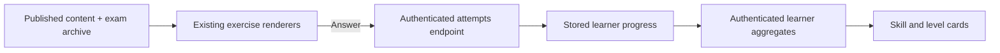

# Practice flow (FRA-93)

Skill and level completion use the same `skillCompletion` presenter and server
aggregates as Home and Profile. The shared skill taxonomy filters published
content plus the exam archive. All content pages are fetched before the exact
question count is shown; the inventory is never silently truncated at 100.

The current level tab is derived from the learner profile; choosing another
level changes only its border. Back navigation preserves the chosen skill and
level. Empty levels cannot be started. Reset all resets local answer state and
does not delete stored attempts or progress. Writing shows a live word count;
speaking offers a type-instead answer, stored as a typed completion without
pretending it is a provider-verified transcript.
