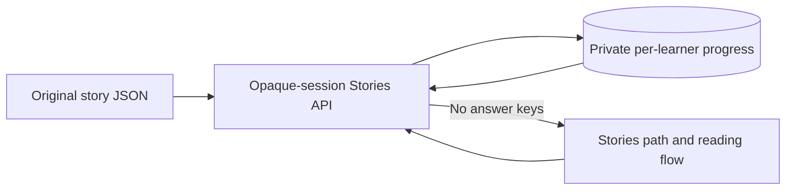

# Stories adventure (FRA-147)

The Stories view reads a server-only catalog from FRA-149. An empty path is
shown during rollout when that catalog has not yet merged. FRA-148 adds its
navigation entry and route. All three branches start at main.

GET /api/me/stories returns summaries; GET /api/me/stories/story-01 returns the
reading and six questions only if unlocked. POST .../answer checks one question;
POST .../skip advances explicitly. Server-side correct-answer sets persist
across devices. A wrong answer never consumes a life or retry. Completion needs
six distinct correct question IDs. Completed and skipped stops remain readable;
finishing a previously skipped story upgrades it to completed.

The frontier is the first story not completed/skipped. Later stories cannot be
opened or mutated by guessing IDs. All writes authenticate through the existing
opaque Bearer session and serialize on the user's row, so concurrent skip/answer
requests cannot overwrite each other's progress. Repeated correct answers do
not increase the count. Client completion claims and user IDs are ignored.

The migration enables RLS without browser policies: this app uses custom server
sessions rather than Supabase Auth. No service key or correct-answer catalog
is imported by frontend code. The trusted backend connection performs all data
access with the authenticated user's ID. Question progress resets on a content
version change while terminal completion/skip history preserves unlocked stops;
stale writes receive 409. Keep stable story IDs/order when updating the catalog.

No production database operation is needed to review the PR: local isolated
PostgreSQL tests apply the migration and exercise the flow. Startup applies the
idempotent migration after merge. Human content review is tracked in FRA-149.
