# Supabase data model

[`schema.sql`](./schema.sql) is the checked-in reference for the PostgreSQL tables, columns, defaults, primary keys, and foreign-key relationships in the Supabase database. It was copied from the Supabase schema export in `dbschema.txt` on 2026-09-26. Treat it as the backend storage model when reading or changing database-backed code.

## How to use this model

- Before writing a query, check the table and column names here.
- When a Supabase database change is made, update this model from the resulting Supabase schema so the repository stays aligned with the database.
- Keep API response shapes separate from this file: API fields can be computed or renamed and do not necessarily match stored columns.
- `server/database.js` connects the API to Supabase PostgreSQL. Its `migrate()` function currently creates only a subset of these tables; the live Supabase schema represented here is broader.
- `scripts/migrate-sqlite-to-supabase.mjs` is a legacy data-transfer utility, not the authoritative model or schema migration mechanism.
- The `private_learner_data` and `private_content_data` migrations enable default-deny RLS on the API-owned tables. Franco uses custom sessions and scoped content keys through the Node API; no direct Supabase Data API policies are intended. The API/import database role must own the tables or bypass RLS (`postgres` is the configured role).

## Relationship overview

```mermaid
erDiagram
  users ||--o{ sessions : has
  users ||--o| learner_profiles : has
  users ||--o{ user_skill_estimates : has
  users ||--o{ attempts : makes
  users ||--o{ mistakes : has
  content_sources ||--o{ example_sentences : provides
  content_sources ||--o{ exam_questions : provides
  content_sources ||--o{ learning_topics : provides
  content_sources ||--o{ tv5_exercises : provides
  example_sentences ||--o{ exercise_items : generates
  cefr_levels ||--o{ concepts : classifies
  concepts ||--o{ concepts : parent_of
  content_sources ||--o{ content_batches : receives
  content_sources ||--o{ content_items : provides
  cefr_levels ||--o{ content_items : classifies
  content_items ||--o{ content_revisions : revises
  content_batches ||--o{ content_revisions : contains
  content_items ||--o{ content_concepts : tagged_with
  concepts ||--o{ content_concepts : classifies
  content_items ||--o{ content_tags : tagged_with
  tags ||--o{ content_tags : labels
  content_items ||--o{ media_assets : has
  content_items ||--o{ content_duplicates : duplicate_candidate
  content_items ||--o{ content_reviews : reviewed
  users ||--o{ learning_attempts : makes
  content_items ||--o{ learning_attempts : receives
  users ||--o{ learner_item_state : tracks
  content_items ||--o{ learner_item_state : scheduled
  users ||--o{ learner_concept_mastery : tracks
  concepts ||--o{ learner_concept_mastery : measures
  concepts ||--o{ concept_prerequisites : requires
```

The diagram shows the foreign keys present in the export. Some logical associations (for example, `attempts.exercise_id`) are plain text columns without declared foreign keys in that schema.

The speech usage ledger is created by supabase/migrations/002_speech_transcriptions.sql or the API startup migration. It stores quota usage and a transcript hash, never audio or plaintext transcripts.
